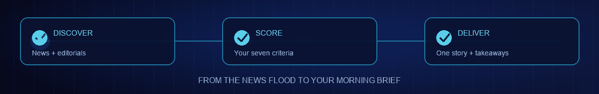
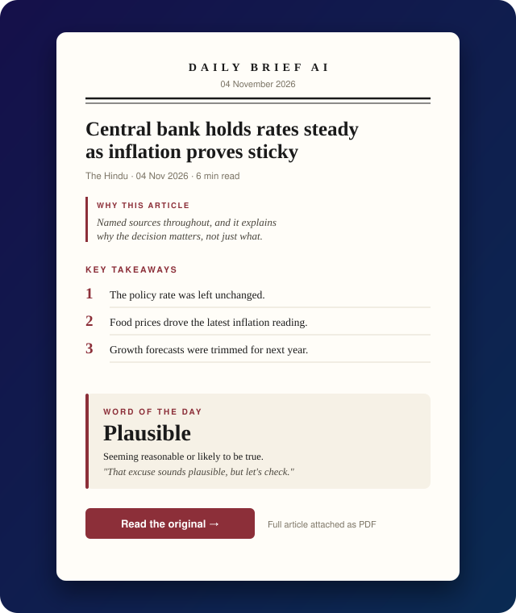
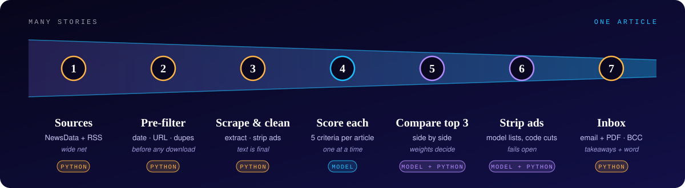
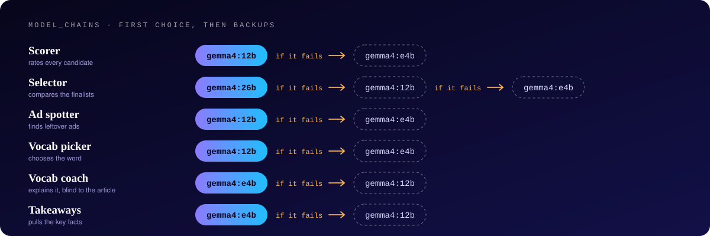

<div align="center">



<sub>PERSONAL AI NEWS EDITOR &nbsp;·&nbsp; OPEN MODELS &nbsp;·&nbsp; ZERO ALWAYS-ON SERVERS</sub>

<p>
<a href="https://github.com/bytebymanas/Sift-AI/actions"></a>
<a href="https://github.com/bytebymanas/Sift-AI/commits/main"></a>
<a href="https://github.com/bytebymanas/Sift-AI/stargazers"></a>
</p>

**[✉ Your Brief](#-the-inbox) &nbsp;·&nbsp; [⌁ The Pipeline](#-the-pipeline) &nbsp;·&nbsp; [⚙ Tune It](#-you-hold-the-dials) &nbsp;·&nbsp; [↗ Get Started](#-setup)**

</div>

<p align="center"></p>

<table align="center" width="100%">
<tr>
<td align="center" width="25%"><sub>THE OUTPUT</sub><br/><h2>01</h2><b>story each morning</b><br/><sub>chosen for substance</sub></td>
<td align="center" width="25%"><sub>YOUR SIGNAL</sub><br/><h2>07</h2><b>weighted criteria</b><br/><sub>tuned to your taste</sub></td>
<td align="center" width="25%"><sub>MODEL BACKUPS</sub><br/><h2>03</h2><b>choices per task</b><br/><sub>automatic on failure</sub></td>
<td align="center" width="25%"><sub>INFERENCE COST</sub><br/><h2>$0</h2><b>no API bill</b><br/><sub>Kaggle GPU shuts down</sub></td>
</tr>
</table>

<p align="center"><sub>WIDE NET IN &nbsp;→&nbsp; ONE CLEAR SIGNAL OUT</sub></p>

## ✦ The Inbox

<table>
<tr>
<td width="46%" valign="middle">



</td>
<td width="54%" valign="middle">

### Something you will actually open

- **Why this article.** One honest line on what set it apart from the rest of the pile
- **Key takeaways.** Concrete facts from the text, never invented
- **Word of the day.** A genuinely useful English word, matched to the vocabulary level you pick, explained without any reference to the article
- **Reading time and a one-tap link** to the original
- **A print-ready PDF** with the full article attached
- **Sent to as many people as you like**, in BCC, so nobody sees anyone else's address
- Looks right in light mode, dark mode and on a phone

> **The article is never rewritten by an AI.** The text is scraped and cleaned by plain code. If an ad slips through, a model only *points at the paragraph* and Python deletes it. Models judge and teach. They never touch the words.

</td>
</tr>
</table>

<br/>

## ✦ The Pipeline

<p align="center"></p>

<sub><b>Amber</b> steps are plain Python. <b>Cyan</b> is a model. <b>Violet</b> is a model proposing and Python deciding. A scheduler pings GitHub Actions, which launches a Kaggle T4 notebook, which installs Ollama, pulls the models and runs everything above. The GPU shuts down when it is done.</sub>

| | Stage | The idea |
| :---: | :--- | :--- |
| **1** | Sources | NewsData for each of your topics (global and India-scoped) plus editorial RSS feeds, cast wide on purpose |
| **2** | Pre-filter | Stale stories, video and gallery URLs, and the same story from five outlets are dropped *before* a single page is downloaded |
| **3** | Scrape and clean | A proper article extractor with a fallback. Subscription prompts, "Also read" lines and duplicate paragraphs are stripped. Truncated paywall pages are caught |
| **4** | Score each | Every candidate is rated alone, so one giant prompt can never bias the result toward the first or last item |
| **5** | Compare the top 3 | The strongest model re-rates the finalists side by side. Python averages both looks and applies your weights |
| **6** | Strip ads | The model lists paragraph numbers. Python removes them, with guard rails, and the step fails open |
| **7** | Inbox | Takeaways and a word of the day are added, then the email and PDF go out in BCC |

**The funnel:** many searches and feeds → 20 to 30 cleaned full-text candidates → 1 article.

<br/>

## ✦ You Hold the Dials

<p align="center"></p>

<br/>

Everything lives in one configuration cell at the top of the notebook. Edit, commit, and tomorrow's run obeys.

```python
USER_CONFIG = {
    "preferred_topics": ["artificial intelligence", "technology", "business", "world news"],
    "include_indian_sources": True,
    "include_global_sources": True,
    "include_editorials": True,

    "preferred_word_range": {"min": 500, "ideal": 750, "max": 1100},
    "ranking_weights": {"writing_quality": 25, "depth_and_context": 20, "topic_relevance": 15,
                        "credibility": 15, "english_learning_value": 15, "freshness": 5, "length_fit": 5},
    "minimum_article_score": 7.2,

    "vocabulary_profile": "Expressive English",   # Foundation · Everyday Edge · Expressive English · Wordsmith
    "takeaway_count": 4,
    "recipients": ["you@example.com", "friend@example.com"],
    "send_full_article_in_pdf": True,
    "dry_run": False,
}
```

Length is a *gentle* factor, never a gate: a flat full score inside your range and a slow slope outside it. A brilliant 1,400-word piece still beats a mediocre 750-word one. Topics are a preference, not a filter, so a great article outside your list still wins.

<br/>

## ✦ Models That Back Each Other Up

<p align="center"></p>

<br/>

Every job gets its own ordered list in `model_chains`. A backup runs only on a **real failure**: an error, a timeout, or output that fails validation twice. Models that did not download are skipped automatically, and the log says which model answered each task. Want a bigger model for the selector? Change one line.

<br/>

## ✦ Built Not To Break

- **Fails open.** If the ad spotter, takeaways or vocabulary step cannot run, that section is simply left out and the email still goes out
- **Fails loudly.** If a whole run dies, you get a short alert at your sender address, and the job still fails visibly for the scheduler
- **No empty days.** If nothing clears your quality bar, the best article is sent and flagged as a lower-confidence pick
- **Dry run mode.** Build the email and PDF without sending a thing
- **Quiet logs.** Secrets are never printed, and model chatter is off

<br/>

## ✦ Setup

<details open>
<summary><b>1 · Clone and point it at your Kaggle account</b></summary>
<br/>

```bash
git clone https://github.com/bytebymanas/sift-ai.git
cd sift-ai
```

Edit `kernel-metadata.json` and put in your username:

```json
{
  "id": "YOUR_KAGGLE_USERNAME/sift-ai-daily-runner",
  "title": "Sift AI Daily Runner",
  "code_file": "sift-ai.ipynb",
  "language": "python",
  "kernel_type": "notebook",
  "is_private": true,
  "enable_gpu": true,
  "enable_internet": true
}
```

</details>

<details>
<summary><b>2 · Add four secrets in Kaggle</b></summary>
<br/>

Push the notebook once (step 4), open it on Kaggle, go to **Add-ons → Secrets**, and attach all four with these exact names.

| Secret | What to put in it |
| :--- | :--- |
| `NEWSDATA_API_KEY` | Your key from [newsdata.io](https://newsdata.io) |
| `GMAIL_ADDRESS` | The Gmail address the brief is sent **from**. Failure alerts also land here |
| `GMAIL_APP_PASSWORD` | A Google **app password** for that account (Security → 2-Step Verification → App passwords) |
| `RECIPIENT_EMAIL` | Who receives the brief. Separate several addresses with commas, or use `recipients` in the config instead |

</details>

<details>
<summary><b>3 · Add Kaggle credentials to GitHub</b></summary>
<br/>

In your repo: **Settings → Secrets and variables → Actions**, add `KAGGLE_USERNAME` and `KAGGLE_KEY` (create the key under your Kaggle account settings).

</details>

<details>
<summary><b>4 · Run it once by hand</b></summary>
<br/>

```bash
export KAGGLE_USERNAME="your_username"
export KAGGLE_KEY="your_api_key"
kaggle kernels push -p .
```

Set `"dry_run": True` for the first run to preview the email without sending it.

</details>

<details>
<summary><b>5 · Schedule it</b></summary>
<br/>

GitHub's own `schedule` can start hours late, so an external scheduler calls the `repository_dispatch` API instead. The workflow file must be on your **default branch**.

1. Create a **fine-grained token** limited to this repo with **Contents: Read and write**
2. Test it. `204` means success and a run appears in the Actions tab:

```bash
read -s TOKEN
curl -i -X POST \
  -H "Authorization: Bearer $TOKEN" -H "Accept: application/vnd.github+json" \
  https://api.github.com/repos/YOUR_GITHUB_USERNAME/sift-ai/dispatches \
  -d '{"event_type":"trigger_colab_run"}'
```

3. On [cron-job.org](https://cron-job.org) create a daily **POST** to that same URL with the headers `Authorization: Bearer YOUR_TOKEN`, `Accept: application/vnd.github+json`, `Content-Type: application/json` and body `{"event_type":"trigger_colab_run"}`. Use **Test run** to confirm `204`

Tokens expire. Note the date and renew it, or the daily run quietly stops. The optional "Check IST time window" step in the workflow skips triggers that arrive outside your chosen hours, so a late trigger never sends a stale brief.

</details>

<br/>

## ✦ Stack and Principles

| | |
| :--- | :--- |
| **Compute** | Kaggle T4 GPU kernels · GitHub Actions · cron-job.org |
| **Models** | Ollama serving Gemma 4, with optional cross-family backups |
| **Agents** | CrewAI, validated with Pydantic |
| **Data** | NewsData API · RSS via `feedparser` · `trafilatura` and BeautifulSoup |
| **Output** | HTML email · WeasyPrint PDF · Gmail SMTP |

**Models judge, code handles the text.** · **Soft rules score, only broken text rejects.** · **Every optional step fails open.** · **No servers, no API bills, no lock-in.**

<br/>

## ✦ Repository

```text
sift-ai/
├── .github/workflows/daily_colab_trigger.yml   # dispatch trigger + optional time-window guard
├── assets/                                      # README graphics
├── LICENSE                                      # proprietary, all rights reserved
├── sift-ai.ipynb                                # the whole pipeline
├── kernel-metadata.json                         # Kaggle GPU execution spec
└── README.md
```

<br/>

## ✦ Releases

| Version | What it brought |
| :---: | :--- |
| **2.0** | One configuration cell for topics, sources, weights, vocabulary level and recipients. Per-criterion scoring with your own weights, scored article by article, then a head-to-head of the finalists. Better extraction with paywall detection and story-level de-duplication. An ad remover where models point and Python deletes. Ordered model chains with automatic fallback. Several recipients in BCC. A redesigned HTML email with dark mode. Dry-run mode and failure alerts |
| **1.0** | The original pipeline: one editor model picks from the pool, two lighter models write takeaways and the word of the day, a PDF is emailed to a single address, all triggered headlessly through Kaggle and GitHub Actions |

<br/>

## ✦ License and Contributions

**Proprietary · All Rights Reserved.** This repository is publicly viewable, but no permission is granted to copy, reuse, modify, or redistribute its code or other project materials. Contributions are not accepted without the copyright holder's prior written permission. See [`LICENSE`](LICENSE) for the full terms.

<br/>

## ✦ FAQ

<details>
<summary><b>Do I need a GPU or a server?</b></summary>
<br/>
No. The Kaggle T4 spins up for the run and shuts down afterwards. A free scheduler and GitHub Actions are all that wake it.
</details>

<details>
<summary><b>Can I send it to several people?</b></summary>
<br/>
Yes. List them in <code>recipients</code> in the configuration cell, or put comma-separated addresses in the <code>RECIPIENT_EMAIL</code> secret. Everyone is in BCC.
</details>

<details>
<summary><b>Can I use different models?</b></summary>
<br/>
Any model Ollama can serve works. Edit <code>model_chains</code> in the configuration cell. The notebook pulls every model it lists, so keep the lists short enough to fit the T4 and the download time you are happy with.
</details>

<details>
<summary><b>Can I trigger a run outside the schedule?</b></summary>
<br/>
Yes. Use <b>Actions → Run workflow</b> at any time, or push the kernel yourself with the Kaggle CLI. If you kept the time-window guard, API-triggered runs outside its hours are skipped.
</details>

<details>
<summary><b>The daily run stopped. What do I check first?</b></summary>
<br/>
Usually the scheduler's GitHub token has expired. Create a new one with Contents: Read and write, update it on cron-job.org, and use <b>Test run</b> to confirm a <code>204</code>.
</details>

<br/>

<div align="center">

**Built by Manas**

<sub>Sift through the noise. Keep the signal.</sub>

</div>
